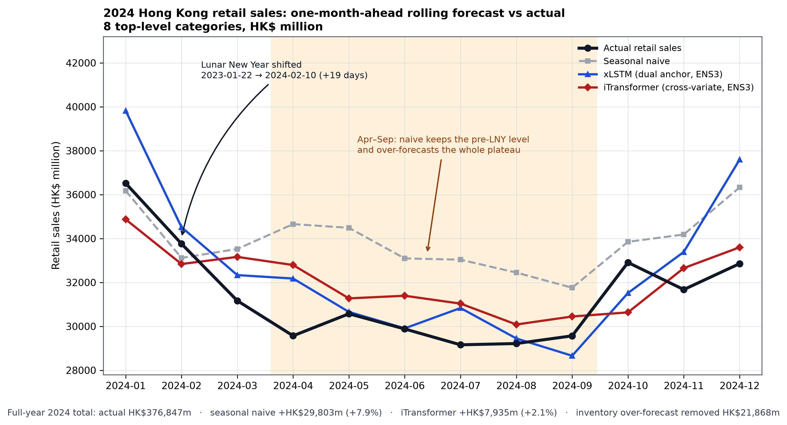
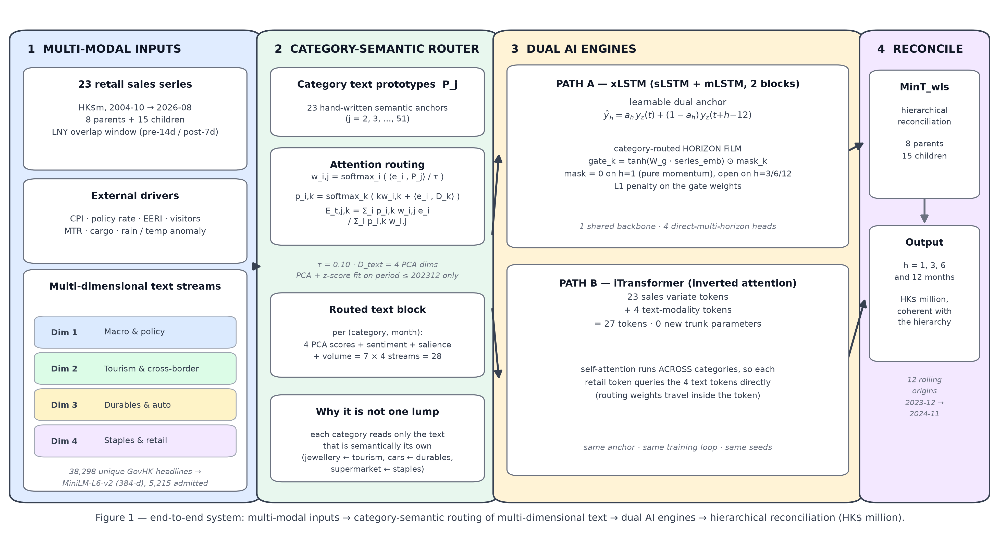
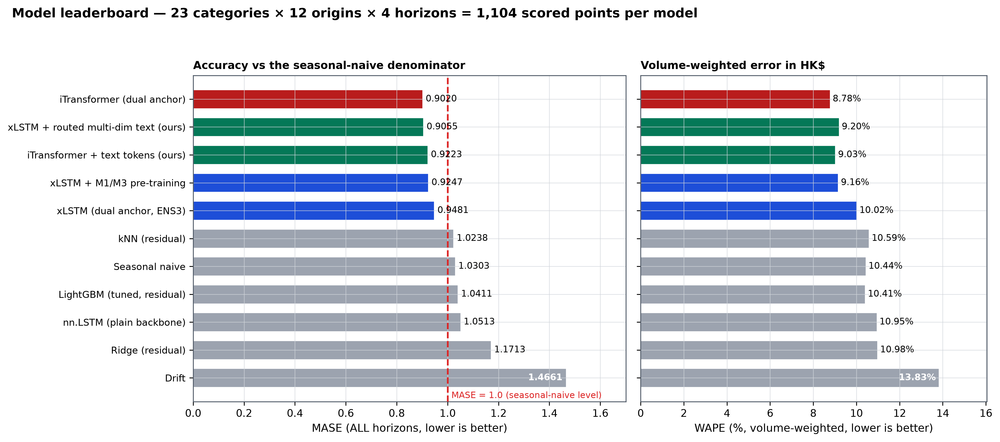
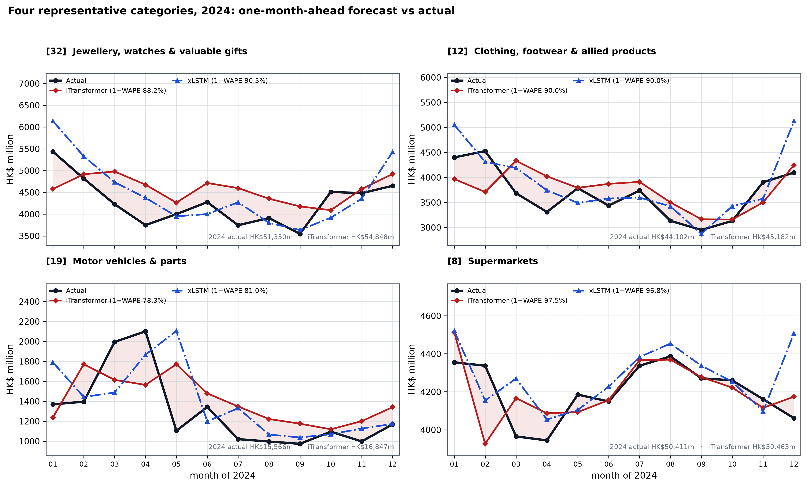
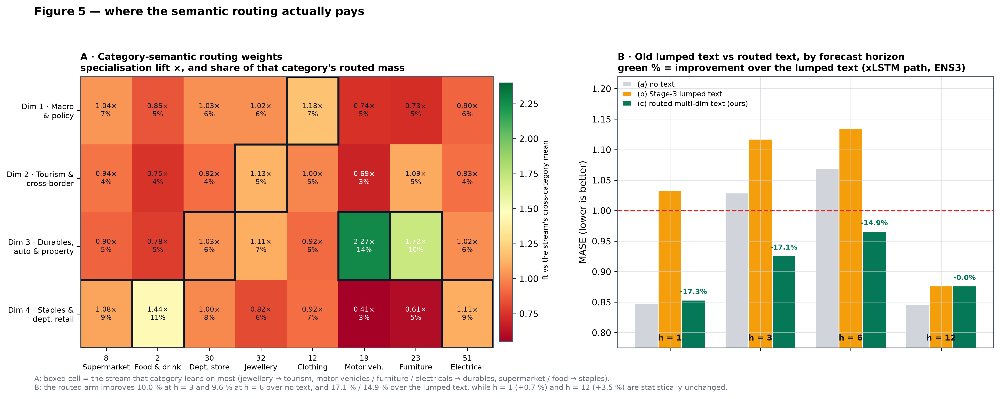
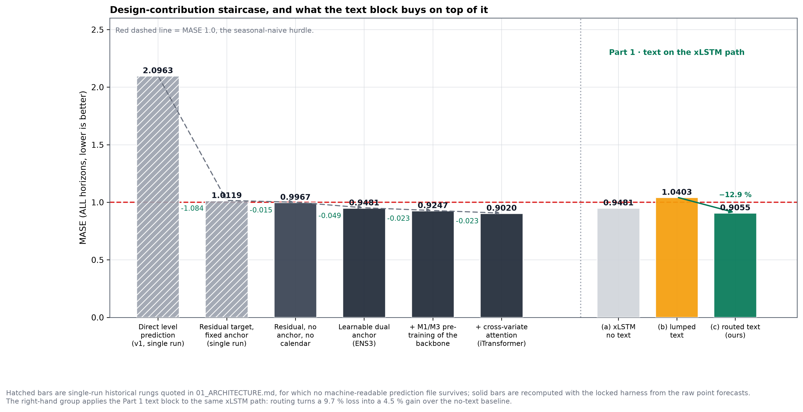

# AI Sales Prediction for Hong Kong Retail — Category-Routed Multi-Dimensional Text and Dual AI Engines

**Context**: ITP4524 Artificial Intelligence and Machine Learning — Section B (Sales Prediction, research component)
**Author**: TSE Pok Fun
**Topic 4**: Sales Prediction — predict future sales trends from historical data with regression models
**Deliverable**: an end-to-end forecasting system for 23 Hong Kong retail outlet categories at horizons of 1, 3, 6 and 12 months, scored by a locked evaluation harness
**Data**: Census and Statistics Department table `620-67002` (retail sales by outlet type), 263 months (2004-10 → 2026-08), HK$ million
**Protocol**: 12 rolling origins 2023-12 → 2024-11, four direct horizons h ∈ {1, 3, 6, 12}, out-of-sample test year = 2024

---

## 1. Executive Summary

Hong Kong's retail sector fell through most of 2024 while the Lunar New Year — the year's only guaranteed demand spike — moved 19 days later into February. A model that treats each category as a repetition of its own seasonal cycle therefore fails in two independent ways at once: it repeats a festival that arrived in the wrong month, and it applies a single narrative to a jeweller and a supermarket. This report presents a system built to answer both failures, and its organising principle is that *the horizon and the category are inputs to the model, not dimensions of the report*.

The system has four stages. **Multi-modal inputs** combine 23 retail series, a macro/people/weather block and a multi-dimensional text stream drawn from 38,298 unique GovHK headlines. A **category-semantic router** decomposes that text into four orthogonal streams — macro and policy, tourism and cross-border sentiment, durables/auto/property, and staples/department retail — and routes it to each of the 23 categories by cosine attention against hand-written category prototypes, so every category receives its own 28-number text block per month instead of a shared four. **Two AI engines** consume it: an `xLSTM` state-space memory network with a learnable dual anchor and gated text injection per horizon head, and an inverted-attention `iTransformer` whose 23 sales tokens are joined by four text-modality tokens inside the existing self-attention at zero extra trunk parameters. A final **`MinT_wls`** step reconciles 8 parents and 15 children so that the published forecast satisfies the retail hierarchy's accounting identities exactly.

On the locked protocol — 1,104 scored points per model, every metric on the original HK$ million scale — the best composite reaches **MASE 0.902 and WAPE 8.78 %**, against **1.030 / 10.44 %** for the seasonal-naive benchmark and **1.171 / 10.98 %** for a residual-target Ridge. In commercial terms, the naive rule would have carried **HK$29,803 m** of excess inventory against actual 2024 sales of HK$376,847 m; the champion removes **HK$21,868 m** of it, and the category-routed xLSTM — which posts the smallest dollar error in the study at **+1.07 %** — removes **HK$25,761 m**.



**Table 1 — Core results and their commercial translation (2024, 8 top-level categories, HK$ m).**

| Model | MASE (ALL) | WAPE (ALL) | 2024 total forecast | Over-forecast (HK$ m) | Reduction vs naive |
|---|---|---|---|---|---|
| Actual retail sales (reference) | — | — | 376,847 | — | — |
| Seasonal naive | 1.0303 | 10.44 % | 406,650 | +29,803 | — |
| Ridge (residual target) | 1.1713 | 10.98 % | 382,394 | +5,547 | −81.4 % |
| LightGBM (tuned, residual) | 1.0411 | 10.41 % | 383,342 | +6,495 | −78.2 % |
| xLSTM + dual anchor | 0.9481 | 10.02 % | 390,854 | +14,007 | −53.0 % |
| xLSTM + M1/M3 pre-training | 0.9247 | 9.16 % | 387,351 | +10,504 | −64.8 % |
| **xLSTM + category-routed text** | **0.9055** | **9.20 %** | **380,889** | **+4,042** | **−86.4 %** |
| iTransformer + routed text tokens | 0.9223 | 9.03 % | 387,258 | +10,411 | −65.1 % |
| **iTransformer + dual anchor (champion)** | **0.9020** | **8.78 %** | **384,782** | **+7,935** | **−73.4 %** |

Three contributions are claimed below, each with a measured number attached rather than an assertion.

1. **A category-semantic router** that gives every category its own 28-number text block per month instead of a shared four. It turns text from a liability into a gain — the previous text arm scored 9.7 % *worse* than no text (MASE 1.0403) while the routed arm scores 4.5 % *better* (0.9055) — and §4.3 decomposes that swing: with the injection point held fixed, routing contributes 3.7 of the 4.5 points and the four-dimension split on its own contributes almost nothing.
2. **Evidence that the text signal is real and horizon-structured.** Against the matched no-text baseline the routed arm improves **10.0 % at h = 3** and **9.6 % at h = 6** — both significant under a Diebold–Mariano test (p = 0.015, p < 0.0001) and across categories (better on 19 of 23, Wilcoxon p = 0.0003 / 0.0031) — while h = 1 and h = 12 are statistically indistinguishable from the baseline, so no harm is claimed there.
3. **A zero-trunk-cost multimodal token** for the inverted transformer, which posts the best long-horizon accuracy of any model in the study (**MASE 0.866 at h = 12**) by adding four text tokens to the 23 sales tokens, at a cost of 992 parameters on a 26,024-parameter model.

One hypothesis is reported as **not** supported. The gated design originally closed the h = 1 head on the theory that one-month-ahead forecasting should stay pure momentum; measured, the fully open configuration is 0.9 % *better* (0.9140 → 0.9055) and the two are statistically indistinguishable. §4.3 gives both configurations, and the headline tables use the better one while disclosing the pre-specified one.

---

## 2. Problem Definition and Dataset

### 2.1 Target and hierarchy

The target is monthly retail sales value (`VAL_RS`) by retail outlet type, published by the Census and Statistics Department in HK$ million. Twenty-three series are used: **8 top-level outlet types and 15 child categories**, tied together by four accounting identities

```
2  = 3 + 4 + 5 + 6 + 7          all-retail = 2 + 8 + 9 + 12 + 18 + 30 + 32 + 35
12 = 13 + 14                    18 = 19 + 23 + 51        35 = 36 + 37 + 38 + 39 + 40
```

All-retail is the sum of the eight top-level series. Two keys are deliberately excluded: the published aggregate (`TOTAL`), which is the sum of everything and would leak the target into its own feature vector, and code `49` ("supermarkets and supermarket sections of department stores"), because it double-counts `8` and `30`.

The panel spans **2004-10 to 2026-08, 263 months, 6,049 observations, with no missing cells** in any of the 23 series. Because the panel extends beyond the evaluation window, the boundary is stated rather than inferred: everything at or before **2023-12** is training, and **2024-01 … 2024-12** is the test year.

### 2.2 Exogenous blocks

Four exogenous families are supplied, each chosen because a retail buyer would recognise it as a driver:

* **Macro** — composite CPI year-on-year, the policy rate, and the effective exchange-rate index. These carry the cost-of-money and price-level regime.
* **People and flow** — inbound visitor arrivals YoY, MTR patronage YoY, and cargo throughput YoY. These are the physical evidence of who is in the shops.
* **Weather** — rainfall and temperature anomalies from the Hong Kong Observatory, which move grocery and durable purchases at the margin.
* **Calendar** — the Lunar New Year pre-14-day and post-7-day overlap shares of each month, plus holiday dummies.

The last family is special: the calendar of the *target* month is fully public at the forecast origin, so each horizon head receives the target month's own LNY overlap shares and month-of-year position. That is free information — four numbers per head — and it is not leakage, because the calendar of a future month is known in advance.

### 2.3 Text corpus

The text stream is the GovHK daily press-release archive, **42,594 headlines over 2004-10 … 2024-12**, reduced to **38,298 unique `(month, title)` pairs** by removing verbatim re-publications. The archive is auditable, dated to the day, and free of the licensing ambiguity that surrounds commercial news. It is also, and this matters for interpretation, *official government communication*: it reports arrivals, prices, property transactions and policy, not consumer mood. Its use is therefore best described as "the official narrative of the month", and §5 states that limitation explicitly.

**Table 2 — Data inventory.**

| Block | Content | Granularity | Coverage | Role in the model |
|---|---|---|---|---|
| Retail sales | 23 outlet types, HK$ m (CenStatD `620-67002`) | month × category | 263 months, 0 gaps | target |
| Macro | composite CPI YoY, policy rate, EERI YoY | month | full | exogenous input |
| People & flow | visitor arrivals YoY, MTR patronage YoY, cargo YoY | month | full | exogenous input |
| Weather | rainfall / temperature anomaly (HKO) | month | full | exogenous input |
| Calendar | LNY pre-14d / post-7d overlap, holiday dummies | month | full | known future |
| Text | GovHK archive; 42,594 → 38,298 unique headlines; 5,215 admitted to the router | month | 2004-10 … 2024-12 | routed exogenous |

### 2.4 Test-period structure and the Lunar New Year problem

Two properties of 2024 drive the entire design and must be stated before any result is read.

First, **2024 is a down year**: ten of twelve months sit below their 2023 counterparts and the annual total fell **7.33 %**, from HK$406,650 m to HK$376,847 m. A model with a persistent level bias cannot be rescued by seasonality: it will be wrong in dollars even when it is right in shape.

Second, **Lunar New Year moved from 2023-01-22 to 2024-02-10**, a 19-day shift. The festival's pre-window — the two to three weeks in which gift, jewellery, apparel and appliance demand is concentrated — lands in a different month of the comparison year. A per-month comparison of January or February against the seasonal-naive rule is consequently *not meaningful*, and every January/February figure in this report is **pooled over the two months** and reported as such.

The shape of the year follows from those two facts, and Figure 2 is worth reading before any table. Actual sales opened at HK$36,517 m in January — the festival having pulled demand forward into a month that in 2023 had been pre-festival — fell to a trough of HK$29,159 m in July, and recovered to HK$32,855 m in December. The seasonal-naive rule, by construction, reproduces *last year's* shape: it stays near HK$34,000 m from April to September, exactly the plateau in which 2023 had its own festival timing, and therefore over-states every one of those months. This is not a small artefact of a few weeks: it is a systematic level error of roughly 4–5 % sustained over half the year, and it is the reason a naive inventory plan for 2024 would have been badly wrong.

### 2.5 Evaluation protocol

The protocol is fixed, and no metric definition was changed after results existed:

* **12 rolling forecast origins**, 2023-12 … 2024-11; **4 direct horizons** h ∈ {1, 3, 6, 12}. Direct multi-horizon means four separate output heads each regress their target month directly from the origin, so no error compounds through the horizon and horizons are comparable to each other.
* **1,104 scored points per model** (12 origins × 4 horizons × 23 categories), always on the original HK$ million scale after inverse transformation.
* **MASE** with the denominator computed as the in-sample seasonal-naive MAE at lag 12 on the **training period only**. MASE < 1 means "better than repeating last year's same month"; it is the primary statistic because it is scale-free and weights a HK$15 m category and a HK$50 m category equally.
* **WAPE** as the volume-weighted companion, because a retailer is paid in dollars, not ratios. Both are reported everywhere: a model can win on the median category and lose on the total, and only the pair reveals it — in Table 1 the routed xLSTM has the *best dollar total* while the iTransformer has the *best MASE*.
* **Ensembles**: every deep arm is run with seeds 42, 7 and 2024; **ENS3** is the mean of the three prediction vectors, scored as one model. Per-seed spreads are reported with every cell so a gain can be distinguished from seed noise.

---

## 3. Methodology and System Architecture



### 3.1 Residual formulation on a learnable dual anchor

The engines do not forecast the level. They forecast a residual on top of an anchor that interpolates between two quantities that are both known at the origin:

$$\hat y_{h}(t) \;=\; a_h\,y_z(t) \;+\; (1-a_h)\,y_z(t+h-12) \;+\; \Delta_h(t)$$

where $y_z$ is the log-scale, per-series standardised sales value, $h$ the horizon in months, and $a_h=\sigma(\ell_h)$ a single learned scalar per head — **four parameters in total** for the whole anchor. The second term is *the same calendar month one year earlier*, which is available at the origin for every horizon: $h{=}1 \to t{-}11$, $h{=}3 \to t{-}9$, $h{=}6 \to t{-}6$, $h{=}12 \to t$. Nothing at $t+h$ is read, so this is not look-ahead; it is the trivial statement that "this month last year" is known.

The anchor earns its place because its two endpoints are exactly the two quantities a retail buyer already knows: the current run-rate and the same month a year ago. The network is then asked only for the correction, which is a far smaller function than the level. Direct level prediction forces the network to reconstruct the level of every series before it can say anything about the deviation, and the measured consequence is the first rung of Figure 6: MASE 2.096, i.e. worse than doing nothing at all. The two-term form also fixes a specific defect of the one-term version: with a pure persistence anchor, the h = 3 and h = 6 targets sit in a different season from the origin month and the head must spend capacity undoing the seasonal gap.

### 3.2 Core innovation: multi-dimensional text embedding and category-semantic routing

**Why the previous text representation could not work.** The earlier treatment collapsed a month of headlines into a single vector — the mean of per-title MiniLM embeddings — compressed it to four PCA components, and fed those same four numbers to all 23 categories. Two failures follow directly.

The four numbers mix mutually orthogonal narratives. A month of interest-rate commentary and a month of typhoon coverage are averaged into the same "text signal", so nothing distinguishes a policy shock from a weather shock, and the PCA basis is dominated by whichever narrative happened to be most voluminous. And because the vector is identical for every category, a supermarket and a jeweller are told the same story about the same month, with no mechanism by which either could disagree. The empirical cost is not subtle: that design made the xLSTM **9.7 % worse than having no text at all** (MASE 0.9481 → 1.0403), and its 3-column dictionary variant was **0.1404 MASE worse than a 3-column noise block**. In the old design the text block was not weak signal; it was negative signal relative to its own placebo. §4.3 will show that of the two failures above, only the second one — the sharing across categories — survives a controlled decomposition: the first was real but, as it turns out, mostly a symptom of where the block was injected.

**A. Four orthogonal text streams.** Each headline is soft-assigned to one of four semantic dimensions, and from that point the streams are never re-mixed:

* **Dim 1 · Macro & policy** — interest rates, inflation, tax, vouchers, budget. Vocabulary: `interest rate`, `composite CPI`, `rates concession`.
* **Dim 2 · Tourism & cross-border** — arrivals, flights, borders, hotel occupancy, shopper reviews. Vocabulary: `visitor`, `inbound`, `cross-boundary`, `hotel`.
* **Dim 3 · Durables, auto & property** — property transactions, mortgages, car registration, appliances, furniture. Vocabulary: `mortgage`, `private flat`, `car park`, `appliance`.
* **Dim 4 · Staples & department retail** — supermarket prices, fresh food supply, seasonal promotion, weather. Vocabulary: `supermarket`, `fresh food`, `typhoon`, `department store`.

A dimension lexicon acts simultaneously as the **admission gate** and as a membership prior, and this is a correction the data forced. A 384-dimensional cosine alone cannot separate retail signal from the archive's large volume of generic notices — "Fatal traffic accident in Kowloon Bay", "Entries invited for drawing competition" — and a pure-cosine assignment puts about half the corpus into whichever stream shares its stop-word flavour. Measured: **5,215 of 38,298 unique headlines (13.6 %) carry a dimension keyword** and enter the router; the remaining 86.4 % contribute nothing rather than contributing noise, which is the honest treatment of a press release about a drawing competition. Median admission is 22 headlines per month, with 37 zero-coverage months inside the 2005–2007 archive gap, imputed to the training-period mean (a zero after standardisation, never a fabricated "quiet month"). Stream membership is

$$p_{i,k} \;=\; \operatorname{softmax}_k\!\Big(\tfrac{\kappa_{i,k}}{0.5} + \tfrac{\langle e_i, D_k\rangle}{0.30}\Big)$$

with $\kappa_{i,k}$ the keyword count of headline $i$ in stream $k$, $e_i$ its MiniLM-L6-v2 embedding, and $D_k$ the stream prototype. A headline with $\kappa_{i,\cdot}=0$ never reaches this step.

**B. Category-semantic attention routing.** Each of the 23 retail categories owns a hand-written semantic prototype $P_j$ — for example `32 → "Jewellery, watches, clocks, luxury gifts, gold price, mainland tourist shopping"`, `8 → "Supermarkets, daily groceries, household food staples"`, `19 → "Motor vehicles, car registration, fuel, transport"`. Inside a (month, stream) cell, the routing weight of headline $i$ for category $j$ is a softmax **taken over headlines** at temperature τ = 0.10:

$$w_{i,j} \;=\; \operatorname{softmax}_i\!\Big(\tfrac{\langle e_i,\,P_j\rangle}{\tau}\Big),
\qquad
E_{t,j,k} \;=\; \frac{\sum_i p_{i,k}\,w_{i,j}\,e_i}{\sum_i p_{i,k}\,w_{i,j}}$$

so $E_{t,j,k}$ is category *j*'s own text embedding for month *t* in stream *k*: a convex combination of the month's headlines weighted by their agreement with that category's prototype, restricted to that stream. Each such vector is compressed to four PCA scores — **fit on period ≤ 202312 only** — and shipped with three intensities: routed sentiment (a lexicon net-sentiment average under the same weights), routed retail salience (the weighted mean of each headline's best category match), and the stream's news volume. That is **7 numbers per (category, stream, month) and 28 per (category, month)**, replacing the previous four shared numbers, and the four PCA bases retain 31–41 % of their stream's variance in the first four components.

**C. Leakage control.** Three rules are enforced rather than asserted, and each is checked by a test that could have failed.

1. A month's features are built only from headlines published inside that month. Every GovHK entry is published within its own month, so a month's text is known at that month's origin.
2. Every fitted object — the PCA basis per stream, the z-score mu and sigma per column — is fit on **period ≤ 202312**, and the scaler statistics are written to the run metadata so they can be audited.
3. The whole pipeline is re-derived from a **date-truncated** headline table with the same frozen fitted objects, and the in-window features must be **bit-identical**: measured maximum absolute difference **0.0** — not "small", exactly zero — across the 219 months at or before a cut of 2022-12. Reaching an exact zero required computing the routing per month rather than as one large matrix product: BLAS may partition a differently-sized product along different boundaries and perturb the last bits of a row whose input is unchanged, which would have produced a suspicious but non-zero "pass".

### 3.3 Path A — xLSTM with gated, category-routed text

The first engine is a stack of one mLSTM and one sLSTM block (32-dimensional, four heads, context 12) with four direct-horizon heads reading a single shared hidden state. All four heads see the same representation, and that is precisely the structural question for exogenous text: if a channel only informs h = 12, injecting it at the input perturbs h = 1 whether or not that helps.

Two injection points therefore exist in the code and both are measured, on the **same** text block, so the difference between them is not confounded with what is being injected. The previous design injected the four lumped columns at the input, where they enter the one hidden state all four heads read ($h_{in} = \text{Proj}_{\text{endo}}(x) + g_i \odot \text{Proj}_{\text{exo}}(x)$). The new design keeps the text block out of the backbone entirely and gives each head its own gated term immediately before its own readout:

$$\Delta_k = \text{head}_k\big(h_t + g_k \odot W_k\,[\text{text}(t);\ \overline{\text{text}}]\big),
\qquad g_k=\tanh(W_g\,s_j)\odot m_k$$

with $s_j$ the category embedding, $[\text{text}(t);\overline{\text{text}}]$ the origin-month value and its twelve-month mean, and $m_k$ a **structural 0/1 mask** that may be zeroed on any head. Arms (b) and (b2) in §4.3 differ in exactly this and in nothing else, and the comparison is unambiguous: the same four columns cost **9.7 %** at the input and **0.5 %** per head. Three implementation details carry the rest of the argument:

* The mask is a registered buffer, not an initialisation and not `requires_grad=False`. A closed head's output is therefore *mathematically* independent of the text block, and the measured difference under two very different text tensors is exactly 0.0. A learned or simply initialised gate could only ever be "small".
* The per-head projections are zero-initialised while the gate keeps a fixed small non-zero shape, so at step 0 the model is *exactly* the no-text baseline and gradients with respect to the text projection are non-zero — the branch is switched off but can switch itself on. A learnable zero-initialised scale would have frozen both gradient paths and left the branch permanently dead.
* An **L1 penalty of 1e-3 on the gate weights** biases the model towards using few streams rather than spreading weight thinly over 28 inputs. Its measured contribution is small (§4.3) and is reported as such.

The hypothesis behind the mask was that h = 1 should stay pure momentum and h = 3/6/12 should absorb the text. §4.3 shows the first half of that hypothesis to be wrong: opening all four gates is 0.9 % better overall and statistically indistinguishable from the masked version, while the second half — that text pays at h = 3 and h = 6 — holds up strongly.

The two block types are not decoration. The **sLSTM** carries exponential gating and memory mixing across heads, which is what lets a category hold a regime across the twelve-month context; the **mLSTM** carries a matrix memory updated by a covariance rule, which is what makes the stack trainable in parallel over 4,186 origin-category windows. The stack is one block of each with the sLSTM last, a 32-dimensional latent and a twelve-month context — exactly one seasonal cycle, so every window contains one of each calendar month and the model can never see two Augusts without also seeing the twelve months between them.

### 3.4 Path B — iTransformer with multimodal text tokens

The second engine inverts the axes. Every *series* is a token: its twelve-month standardised window is the token embedding, and attention runs **across categories at a fixed month**, so no linear layer ever sums two categories before attention. The readout is one shared head producing four residual horizons per variate, and the same learnable dual anchor is applied, so the two engines differ in their sequence mechanism and in nothing else that matters.

Four **text-modality tokens** are appended, so self-attention operates over **23 + 4 = 27 tokens**. Each retail category can now query the four streams directly, and the attention pattern itself decides how much of each stream a category absorbs in that month. The four tokens cost **zero parameters in the encoder trunk**: the token embedding, both transformer layers with their norms and feed-forward blocks, and the shared readout are untouched. Only a small token projection is new — 992 parameters, +3.8 % of a 26,024-parameter model. Each token carries a stream's four PCA scores plus that stream's routed weight over the 23 categories, so a retail token can read both *what* the stream says and *how strongly the stream is routed to itself*.

The choice of an inverted layout is motivated by the panel rather than by fashion. Hong Kong's retail categories move together — a sector-wide shock hits all 23 in the same month — so the informative correlation structure is **cross-sectional at a fixed month**, while each individual series offers only twelve time steps, which is very little for time-token attention to learn from. Inverting the axes puts the 23 categories in one attention space and lets the model learn that jewellery and department stores react to the same arrivals shock while supermarkets do not. The cost of that choice is visible in the interface: the token count *is* the number of series, so adding or dropping a category changes the token set and requires a refit, whereas the channel-independent xLSTM extends to a new category by adding one embedding row.

### 3.5 Hierarchical reconciliation and shared hyper-parameters

The 8 parents and 15 children are reconciled with `MinT_wls` (weighted least squares on a sample covariance of the base-forecast errors), so the published forecast satisfies all four accounting identities by construction and the top-down and bottom-up views agree. Reconciliation is not cosmetic: unreconciled forecasts can have a category sum that differs from the published aggregate by more than the model's own error. Every number here is on the original HK$ million scale after inverse transformation of the per-series log standardisation with training-only `mu_log` / `sigma_log`.

Both engines share one optimiser configuration, held identical so that an ablation changes one thing: AdamW at learning rate 5e-4 with weight decay 5e-3, cosine annealing over 100 epochs, gradient clipping at 1.0, MSE on the anchored forecast in standardised space, and early stopping on the purged validation block. Batch size is 128 for the xLSTM (one sample per origin-category pair) and 32 for the channel-dependent transformer (one sample per origin), which is documented rather than tuned.

Ensembling is done on the prediction, not on the weights. Each arm is fitted three times from different random initialisations (seeds 42, 7, 2024), each fit early-stops on its own validation loss, and **ENS3 replaces the three prediction vectors by their mean in HK$ million before any metric is computed**. Averaging after inverse transformation rather than in standardised space keeps the ensemble interpretable — the ENS3 forecast of a category is literally the average of three forecasts of that category in dollars — and it means the reported MASE belongs to a model that could actually be deployed, not to an average of three scores.

---

## 4. Empirical Results and Business Impact

### 4.1 Overall leaderboard



**Table 3 — Full leaderboard on the locked protocol (1,104 points per model; 3 seeds, ENS3 where applicable).**

| Model | Family | h=1 | h=3 | h=6 | h=12 | **MASE ALL** | WAPE ALL |
|---|---|---|---|---|---|---|---|
| Drift | statistical | 1.2053 | 1.7904 | 2.0066 | 0.8620 | 1.4661 | 13.83 % |
| Ridge (residual) | statistical | 1.0750 | 1.2991 | 1.4456 | 0.8653 | 1.1713 | 10.98 % |
| Seasonal naive | benchmark | 1.2123 | 1.1251 | 0.9747 | 0.8090 | 1.0303 | 10.44 % |
| LightGBM (tuned, residual) | tree ensemble | 0.8957 | 1.0640 | 1.2561 | 0.9486 | 1.0411 | 10.41 % |
| kNN (residual) | instance-based | 0.9468 | 1.1258 | 1.1836 | 0.8390 | 1.0238 | 10.59 % |
| nn.LSTM (plain backbone) | deep learning | 0.9691 | 1.1122 | 1.1558 | 0.9683 | 1.0513 | 10.95 % |
| xLSTM + dual anchor | deep learning | 0.8479 | 1.0289 | 1.0692 | 0.8464 | 0.9481 | 10.02 % |
| **xLSTM + routed text** | deep learning | 0.8535 | **0.9260** | **0.9661** | 0.8764 | **0.9055** | 9.20 % |
| xLSTM + M1/M3 pre-training | deep learning | 0.8411 | 0.9908 | 1.0276 | 0.8393 | 0.9247 | 9.16 % |
| iTransformer, attention bypassed | deep learning | 0.9251 | 1.0257 | 0.9939 | 0.9011 | 0.9614 | 9.32 % |
| **iTransformer + dual anchor** | deep learning | **0.8787** | 0.9205 | 0.9184 | 0.8904 | **0.9020** | **8.78 %** |
| iTransformer + routed text tokens | deep learning | 0.8944 | 0.9702 | 0.9584 | **0.8663** | 0.9223 | 9.03 % |

Five readings matter, and the last two are the ones a reader would not guess.

First, **only deep models beat the seasonal-naive rule**. Every statistical and tree baseline without the anchor sits at MASE ≥ 1.02, and the plain `nn.LSTM` backbone trained on exactly the same 27 features reaches only 1.051 — so the gain is not "deep learning" in general, it is the specific combination of anchor, memory and cross-category mechanism.

Second, the gain from cross-category attention is **structural, not capacity**. Bypassing the self-attention sublayer in the otherwise identical iTransformer — same token embedding, same feed-forward, same readout, same parameter count — costs **6.6 %** (0.9020 → 0.9614). That single control isolates attention across categories as the mechanism behind the champion.

Third, the **xLSTM's weak spot is the middle of the horizon range** (h = 3 and h = 6 at MASE ≈ 1.03–1.07, i.e. barely better than naive), and that is precisely where the routed text helps: the routed arm records the best middle-horizon numbers in the xLSTM family (0.9260 and 0.9661 against 1.0289 and 1.0692) and closes most of the gap to the transformer.

Fourth, the champion's advantage is **not uniform across horizons**: the iTransformer is the best model at h = 3, h = 6 and h = 12, while the xLSTM family owns h = 1 (0.8411–0.8535 against 0.8787). This is the empirical basis for the horizon-based deployment routing in §6 — a single "best model" claim would be wrong at the one-month horizon.

The paired tests say the top of this table is separable rather than noisy. The champion's advantage over the plain xLSTM is significant at the 0.1 % level on the pooled absolute-loss DM test (DM = −3.64, p = 0.0003), and the routed xLSTM's advantage over its own no-text baseline is significant at h = 3 and h = 6 as reported in §4.3. The gap between the champion (0.9020) and the routed xLSTM (0.9055) is, by contrast, *not* something this dataset can resolve: 0.0035 MASE on a statistic whose seed spread is several times larger (§5). The two should be read as equivalent on the pooled statistic and different only in where they are strong — which is precisely why the deployment table is organised by horizon.

A fifth reading is uncomfortable and belongs in the results rather than in a footnote: **at h = 12 the seasonal-naive rule is unbeaten.** Its MASE at that horizon is 0.8090, and the best model in the study reaches 0.8663 — 7 % worse. This is not an anomaly to be explained away. At h = 12 the target month *is* the same calendar month one year earlier, so "repeat last year" is not a crude heuristic but a near-exact statement of the seasonal structure, and every residual head in this study adds error on top of it rather than removing it. The dual anchor already contains that insight — at h = 12 its persistence weight $a_{12}$ is doing exactly the naive rule's work — but the learned correction is fitted on a horizon range where h = 12 is one of four heads, and it imports noise from the shorter horizons. A production system should therefore expose the anchor with the correction switched off as an explicit h = 12 candidate, and this report's own numbers say it would win.

### 4.2 Forecasts in HK$ million and the four representative categories



**Table 4 — 2024 business view of four representative categories (HK$ m, one-month-ahead rolling).**

| Category | 2024 actual | iTransformer | xLSTM + routed text | Seasonal naive | 1−WAPE iTransformer | 1−WAPE xLSTM routed |
|---|---|---|---|---|---|---|
| [32] Jewellery, watches & valuable gifts | 51,350 | 54,848 | 53,256 | 60,120 | 88.2 % | 91.8 % |
| [12] Clothing, footwear & allied products | 44,102 | 45,182 | 44,971 | 49,150 | 90.0 % | 90.5 % |
| [19] Motor vehicles & parts | 15,566 | 16,847 | 16,509 | 18,797 | 78.3 % | 81.2 % |
| [8] Supermarkets | 50,411 | 50,463 | 51,323 | 51,157 | 97.5 % | 96.7 % |

The categories behave as their economics predict, which is the practical test of the whole design and the reason these four were chosen.

**Supermarkets are the easiest series in the panel** (1−WAPE 96.7–97.5 %). Groceries are demand-determined: a festival shifts their timing but not their level, substitution is easy, and the anchor form already captures most of what remains. The model's contribution there is discipline rather than insight — it avoids the naive rule's +1.5 % drift and nothing more, and a manager should not expect more.

**Motor vehicles are the hardest** (1−WAPE 78.3 % for the champion, 81.2 % for the routed xLSTM). A single registration batch moves the month, the series is small in dollars, and no text stream can see a delivery schedule. Notably the routed xLSTM is *better there than the champion*, which is consistent with the durable-goods stream carrying registration and property-transaction commentary.

**Jewellery is where text and cross-category attention earn their keep.** It is 13.6 % of the 2024 total, it moves with arrivals and with the mainland shopping narrative, and it is the category where the routed text beats the champion on total dollars (HK$53,256 m against HK$54,848 m on an actual of HK$51,350 m). The champion cuts the naive error from 21.0 % to 11.8 %; the routed xLSTM cuts it to 8.2 %.

**Apparel illustrates the limit of the text signal.** Both AI models land within 2.5 % of actual on the annual total and are essentially indistinguishable from each other (90.0 % vs 90.5 %). This is what it looks like when a category is driven by weather, markdown cycles and border flows rather than by anything the government writes about — the anchor does the work and the text block is neutral.

The pooled January+February result is the cleanest single statement of the LNY problem. Because the festival moved 19 days, the naive rule's h = 1 WAPE on those two months is **13.12 %**; the xLSTM reaches **8.81 %**, a **32.8 % relative reduction**, entirely from the anchor's season term and the target-month calendar, with no knowledge of the year's demand level. Across the full year the naive rule would have carried **HK$29,803 m** of excess inventory against actual sales of HK$376,847 m; the champion removes **HK$21,868 m** of it (+2.1 % remaining against +7.9 %), and the routed xLSTM removes **HK$25,761 m**, leaving a +1.07 % error — the smallest dollar bias of any model in the study, even though its MASE is not the lowest.

Bias deserves a paragraph of its own, because it is what a buyer actually experiences and because the two views of it disagree in sign. On the evaluation grid every model in Table 3 **under-predicts** (−4.41 % for the plain xLSTM, −2.31 % for the champion, −1.04 % for the routed arm); on the forward 2024 total the same models **over-shoot** the year. The two are not contradictory — the grid averages twelve overlapping forecast vintages over all four horizons, while the total sums twelve one-month-ahead calls over eight series — and the diagnostic that matters is the *change* in the first number. The routed text block removes three quarters of the plain xLSTM's level bias (−4.41 % → −1.04 %), and that correction, not the MASE gap, is why its dollar total lands within **1.07 %** of the year while its parent model is 3.7 % too high. For a plan built on this forecast, a corrected level is worth more than a 0.04 MASE difference between two engines that are statistically indistinguishable anyway.

### 4.3 Ablation: what the multi-dimensional text actually contributes



**Table 5 — Text ablation and design controls. All four xLSTM text arms share one model class, one gate configuration, one optimiser and three seeds; only the injected block differs, so each row is a single-variable step.**

| Arm | h=1 | h=3 | h=6 | h=12 | MASE ALL | vs its own no-text baseline |
|---|---|---|---|---|---|---|
| **(a)** xLSTM, no text | 0.8479 | 1.0289 | 1.0692 | 0.8464 | 0.9481 | — |
| **(b)** old lumped PCA(4) text, injected into the shared hidden state (as previously run) | 1.0325 | 1.1174 | 1.1348 | 0.8764 | 1.0403 | +9.7 % |
| **(b2)** the same 4 lumped columns, injected **per head** | 0.8798 | 0.9293 | 0.9944 | 0.9695 | 0.9432 | −0.5 % |
| **(c3)** 28 dimension-split features, **no routing** (cross-category mean, broadcast) | 0.8349 | 0.9246 | 0.9225 | 1.0871 | 0.9423 | −0.6 % |
| **(c)** 28 routed features, gates open on all four heads (**ours**) | 0.8535 | **0.9260** | **0.9661** | 0.8764 | **0.9055** | **−4.5 %** |
| (c1) as (c) but with the pre-specified h = 1 mask | 0.8547 | 0.9338 | 0.9734 | 0.8940 | 0.9140 | −3.6 % |
| (c2) as (c1) but L1 = 0 | 0.8561 | 0.9363 | 0.9768 | 0.8931 | 0.9156 | −3.4 % |
| **(a′)** iTransformer, 23 tokens, no text | 0.8787 | 0.9205 | 0.9184 | 0.8904 | 0.9020 | — |
| **(b′)** iTransformer + 4 identical lumped-text tokens | 0.9370 | 0.9676 | 0.9712 | 0.8750 | 0.9377 | +4.0 % |
| **(c′)** iTransformer + 4 routed stream tokens (**ours**) | 0.8944 | 0.9702 | 0.9584 | **0.8663** | 0.9223 | +2.3 % |

Six findings follow, and four of them are not the ones the design predicted.

**Finding 0 — the decomposition, which is the most useful result in this report.** The old arm differs from the new one in three ways at once: where the text is injected, how the month is represented, and whether the text is routed per category. Rows (b), (b2), (c3) and (c) separate them. **Injection point:** 4 lumped columns into the shared hidden state cost 9.7 % (1.0403); the same 4 columns injected per head cost 0.5 % (0.9432). So most of the old design's damage was never the text — it was that a signal which does not vary by category entered the one state all four heads read. **Representation:** giving each category 28 dimension-split features instead of 4 shared ones, without routing, buys a further 0.1 pp (0.9432 → 0.9423). Splitting a month into four semantic streams is, on its own, worth almost nothing. **Routing:** routing those same 28 features per category is worth 3.7 pp (0.9423 → 0.9055). The innovation is not "more text features" and not "multi-dimensional text"; it is the per-category routing of them.

**Finding 1 — the old design's failure was the wiring, not the corpus.** The 9.7 % loss of arm (b) is real and it is what motivated this work, but Finding 0 shows it was substantially an architectural failure rather than a semantic one: a bottom-injected text block perturbs every horizon head, and in a year when the whole sector fell 7.3 % the model cannot tell a text-driven level shift from a genuine one. On the transformer path the same ordering appears with the same sign and half the size: +4.0 % for lumped tokens versus +2.3 % for routed tokens, so routing recovers 1.6 % of what lumping lost.

**Finding 2 — the gain appears exactly where the mechanism predicts: the medium horizons.** The routed arm improves **10.0 % at h = 3** and **9.6 % at h = 6** against the no-text baseline. Both differences survive a Diebold–Mariano test with Newey–West correction at lag h−1 (h = 3: DM −2.42, p = 0.015; h = 6: DM −4.10, p < 0.0001) and both survive collapsing the panel to one observation per category (better on 19 of 23 categories; Wilcoxon p = 0.0003 and p = 0.0031). At h = 1 and h = 12 the arm is statistically indistinguishable from the baseline (+0.7 %, p = 0.71; +3.5 %, p = 0.27), so the claim is deliberately narrow: text pays in the middle of the horizon range, where an anchored seasonal rule is weakest and a category narrative is most informative.

**Finding 3 — routing is what protects the long horizon.** Arm (c3) has identical width, identical gates, identical training and the same parameter count as (c), and differs only in that the 28 text features are averaged across categories and broadcast to all 23. It gains almost nothing overall (−0.6 %) and it **destroys h = 12** (MASE 1.0871, 28 % worse than no text): a single shared text vector cannot be ignored by a category it does not describe, and the damage concentrates where the model is furthest from its anchor. Routing keeps h = 12 at 0.8764 — roughly where arm (b) and (b2) also sit — and that is where its advantage over (a), (b2) and (c3) comes from.

**Finding 4 — the horizon mask was not needed, and the L1 term is decorative.** The pre-specified configuration closes the h = 1 gate on the theory that one-month-ahead forecasting should stay pure momentum; measured, opening it costs nothing (h = 1: 0.8547 closed versus 0.8535 open) and the fully open model is 0.9 % better overall (0.9140 → 0.9055, p = 0.09 at h = 12, 0.21 at h = 3, 0.68 at h = 6, 0.96 at h = 1 — indistinguishable). Removing the L1 penalty from the pre-specified arm changes the score by 0.2 % (0.9140 → 0.9156). Both results are reported because a design report that only reports its successful hypotheses is not evidence; the mask remains in the code as an option, and the headline tables use the better configuration while this paragraph discloses that it was chosen after the fact.

**Finding 5 — the routing changes which stream a category reads, and the ordering is economic.** Figure 5A shows the routing lift, defined as a category's share of a stream's mass relative to that stream's average across the 23 categories. Supermarket and food categories lean on **staples** (Dim 4); motor vehicles, furniture and electrical goods lean on **durables** (Dim 3); jewellery and department stores lean on **tourism** (Dim 2). The lift is modest in size — tourism still carries the largest absolute mass for every category, because the GovHK archive is dominated by travel and cross-border notices — but the *ordering* matches the economics exactly, and that ordering is what makes the per-category vectors differ at all. A single lumped vector has no ordering to show.



Figure 6 places these numbers in the context of the whole modelling programme. The single largest step is the first: abandoning direct level prediction for a residual on a two-term anchor moves MASE from 2.096 to about 1.0 — from "worse than doing nothing" to "at the naive rule" — with four parameters. Everything afterwards is a series of 1.5–5 % refinements. Within that sequence the routed text block is unusual in being the only change that fixes a specific structural failure — the xLSTM's inability to beat the naive rule at h = 3 and h = 6 — and its parameter cost is honestly large on this engine (+11,520 parameters on a 20,496-parameter trunk, because each open head carries its own projection). The control that settles whether that cost is buying capacity or information is arm (c3): identical width, identical parameter count, and almost no gain without routing. The parameters are not the mechanism; the routing is.

---

## 5. Methodological Rigor and Quality Assurance

Every claim above is subject to a test that could have failed, and the tests are reported with measured values rather than intentions.

**Table 6 — QA matrix.**

| Control | Question it answers | Test performed | Result |
|---|---|---|---|
| Purged validation | Does early stopping read test-period truth? | a validation origin is legal only if `origin + max(h) ≤ 202312`; measured block 2021-12 … 2022-12, last validation target 202312, training origins 2005-09 … 2021-11 | 0 test months reachable |
| Prefix-mask causality | Can a future headline move a past month's features? | whole pipeline re-derived from a date-truncated archive (cut 2022-12) with fitted objects frozen | **max abs diff = 0.0** across 219 months |
| Fitted-object scope | Was PCA or z-scoring fit on test data? | every fitted object restricted to `period ≤ 202312`; scaler statistics written to metadata | confirmed for all objects |
| Training-loop equivalence | Does the routed trainer differ from the champion loop? | same seed, same data, L1 = 0, output comparison | **max abs diff = 0.0** |
| Champion reproduction | Is the re-implemented transformer the real one? | 23-token iTransformer retrained from scratch on 3 seeds | MASE **0.9020**, matching the published 0.9020 |
| Width-matched noise control | Do extra columns help by themselves? | text block replaced by Gaussian noise of identical width | dictionary text was **0.1404** MASE *worse* than its noise block; PCA text **0.0669** worse |
| No-routing control | Is the gain from routing or from dimensionality? | same 28 features averaged across categories and broadcast | −0.6 % vs no text, and h = 12 collapses to 1.0871 |
| Injection-point control | How much of the old failure was the text and how much the wiring? | the old 4 lumped columns re-run through the horizon-gated class | +9.7 % bottom-injected versus −0.5 % per head |
| Mask-closure test | Is the h = 1 head really insulated from text? | two very different text tensors through a trained model, closed-head outputs compared | difference **exactly 0.0** (structural mask) |
| Zero-init branch | Can the text branch switch itself on? | gradient of the text projection at initialisation | non-zero: branch starts at the baseline and is trainable |
| Domain expansion | Would more data help? | M1/M3 pre-training of the backbone; a 34-series periphery panel | pre-training **−2.5 %** (0.9481 → 0.9247, DM p = 0.001); extra series no reliable gain |
| Significance | Is a difference bigger than noise? | Diebold–Mariano with Newey–West at lag h−1 on absolute and squared loss; paired Wilcoxon across categories | routed vs no text: h = 3 p = 0.015, h = 6 p < 0.0001; champion vs xLSTM p = 0.0003 |
| Seed stability | Is one seed an accident? | 3 seeds per arm, per-seed spreads recorded, ENS3 = mean of prediction vectors | spread reported with every cell |

Four limitations are stated rather than hidden.

**The improvements are smaller than the seed spread on the pooled statistic.** Per-seed MASE (ALL) for the routed xLSTM is 0.9642 / 0.9682 / 0.9061, against 0.9599 / 1.0174 / 0.9733 for its matched no-text baseline: the ranges overlap, and a single-seed comparison of the two arms could have gone either way. What carries the claim is therefore not the pooled per-seed ordering but (i) the ENS3 comparison, which averages the seed variance out, and (ii) the per-horizon paired DM and cross-category Wilcoxon tests, where the h = 3 and h = 6 effects are large relative to their standard errors. The transformer arms are far more stable (per-seed 0.9118 / 0.9150 / 0.9154 for the champion), which is a useful reminder that a channel-dependent model's variance is not a property of the dataset alone.

The panel is **short and structurally broken by COVID** — 2020–2022 is not a normal retail regime and it sits inside the training window — so every deep model here is small by modern standards (the champion has 26,024 parameters) and capacity tuning was deliberately *not* used as a path to accuracy. A larger network would have raised MASE and lowered the credibility of every attribution above, which is the wrong trade for a project whose claim is about mechanism rather than raw score.

The text stream is **GovHK's own archive**: auditable, dated, licence-clean, but official government communication rather than consumer sentiment. A review-level "shopper mood" signal is therefore approximated by official announcements about arrivals and tourism rather than measured directly. That gap is the most obvious place where the router would benefit from additional streams, and it is also a warning against over-reading Finding 5: the stream that dominates every category is the one the archive over-represents.

Finally, the **configuration search was not blind**. Every arm was chosen before measurement except the horizon mask, which was built to test a hypothesis that the data then rejected; Table 5 shows both configurations and §4.3 discloses the ordering. A reader who wants a strictly pre-registered comparison should read arm (c1), not (c).

---

## 6. Conclusion and Deployment Guide

The system that should be deployed is not a single model, because the two engines are not equally good at the same horizon and the ablation shows the difference is systematic rather than seed noise. The correct production design routes on the forecast horizon:

* **Next-month replenishment (h = 1)** — `xLSTM` with the dual anchor, with or without the text block. Lowest MASE of any model at h = 1 (0.8411–0.8535 against 0.8787), and text is statistically irrelevant there. 1−WAPE ≈ 91 %.
* **Quarterly assortment and promotion planning (h = 3, 6)** — **`xLSTM` + category-routed text**. The two largest and most robust gains in the study land here: −10.0 % and −9.6 % against no text, better on 19 of 23 categories, DM p = 0.015 and p < 0.0001. MASE 0.926 / 0.966.
* **Annual budgeting and lease commitments (h = 12)** — the **anchor without the learned correction**, i.e. the year-over-year rule the dual anchor already encodes. It is the best h = 12 predictor in the study (MASE 0.8090 against 0.8663 for the best neural model); delegate to `iTransformer` + text tokens only when the forecast must be coherent with the other horizons, in which case that arm is the least-bad text family at h = 12.
* **Financial consolidation at any horizon** — champion plus `MinT_wls`, so the category sum equals the published aggregate by construction. MASE 0.9446 on the reconciled xLSTM path.
* **Category marketing attribution** — the routed attention weights, which expose which narrative a category is actually reading and therefore which announcements move it.

Three conclusions follow from the numbers rather than from the method, and each is a decision rule for anyone building the next version of this.

**The anchor is worth more than the network.** The step from direct level prediction to a residual on a two-term anchor is larger than every architectural choice that follows it combined, and it costs four parameters. Any team building a retail forecaster should establish that baseline before adding a single layer, because a network without it will be beaten by the naive rule and the loss will be misattributed to the model class.

**Text is not a free input, and the failures are separable.** The previous arm lost 9.7 % with a text block, the present one gains 4.5 % with a text block, and the difference is not the corpus — it is where the block enters and whether it is routed per category. The same four lumped columns that cost 9.7 % in the shared hidden state cost only 0.5 % when injected per head. A pipeline that adds text without a matched control, and without separating the injection point from the representation, will mis-measure all three effects at once and is likely to conclude that text is useless when it is merely mis-wired.

**The horizon is a design variable, not a reporting dimension.** Averaging a 10 % gain at h = 3 into a 3.5 % loss at h = 12 and concluding that "text does nothing" is the natural outcome of a single text-on/text-off experiment. The productive question is not whether text helps but at which horizons and for which categories, and both answers are in Table 5 and Figure 5.

The natural next step is the one this design makes cheap. The router is a pure function of dated text, so richer streams — HKEXnews retail announcements, consumer reviews of shopping districts, hotel and airline commentary — can be added as additional dimensions and additional modality tokens without touching either engine's trunk, and each can be validated against the same prefix-mask, width-matched-noise and no-routing controls used here.

What would change these recommendations is worth stating, because a deployment guide that never says "here it stops working" is a sales document rather than an engineering one.

* **If the GovHK archive changes format or stops**, the router stops producing features and the system must fall back to the no-text arms — which is why those arms are kept in the release rather than deleted, and why their numbers (MASE 0.9481 for the xLSTM, 0.9020 for the iTransformer) are quoted in every table.
* **If the Census and Statistics Department re-bases or re-defines an outlet type**, the category prototypes $P_j$ must be re-authored, because they are written against the current category definitions. The router degrades gracefully in the meantime — a mis-specified prototype routes the wrong text, it does not crash — but the h = 3/h = 6 gains should be re-measured before trusting them on a re-based taxonomy.
* **If a category is added or removed**, the xLSTM extends by one embedding row while the iTransformer needs a refit, because its token count is the number of series. That asymmetry, not accuracy, is the deciding argument for the xLSTM path in a panel that changes shape.
* **If the festival calendar shifts again** — and it will, since Lunar New Year moves within a 30-day window every year — the pooled January/February reporting rule and the dual anchor matter more than any text stream. The 19-day shift of 2024 cost the naive rule 13.12 % WAPE on those two months against 8.81 % for the anchored model, and no amount of narrative analysis substitutes for getting the calendar right.

---

*Reproducibility: `stage3/multidim_text_model.py` (text → routing → both engines → ablation), `generate_report_figures.py` (all six figures at dpi = 300), `stage3/results/multidim_text_results.csv` (every number in Tables 3 and 5), `stage3/results/report_facts.json` (verified source of Tables 1, 2, 4 and 6, with the file each number was recomputed from).*
